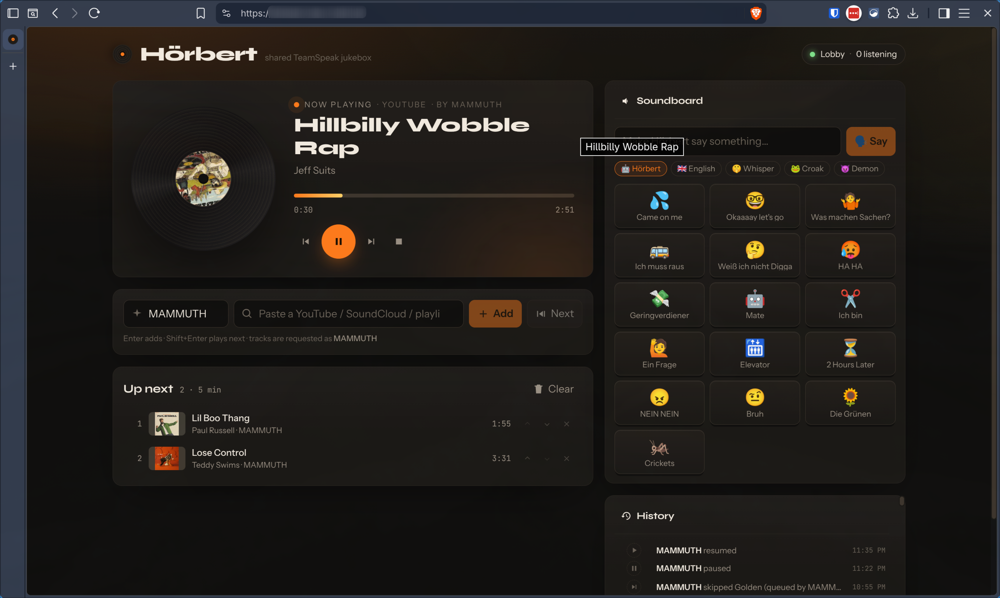

# Hörbert

A TeamSpeak music bot with a soundboard and text to speech.
Control it from a shared web UI or with `!commands` in the chat.



## Features

- **Two ways to control it:** a web UI for the whole channel (queue, search,
  soundboard, history) and chat commands in TeamSpeak. Both drive the same queue.
- **Plays almost anything:** every site [yt-dlp](https://github.com/yt-dlp/yt-dlp)
  supports (YouTube videos, playlists and search, SoundCloud, Bandcamp, …) plus
  direct audio and radio URLs.
- **No ads, no sponsor reads:** yt-dlp fetches the raw audio, and
  [SponsorBlock](https://sponsor.ajay.app/) segments on YouTube are skipped.
- **Soundboard:** your own clips as buttons and `!<name>` commands, mixed over the music.
- **Text to speech:** `!tts hello` makes the bot talk, with silly voices; the music ducks while it does.
- **Shared history:** who queued, skipped or paused what, and when.
- **Good sound:** 48 kHz stereo Opus at 128 kbit/s.
- **Easy to run:** one Docker container, one Rust binary with the web UI built in,
  state in a JSON file. Works with TeamSpeak 3 and 6 servers.

## Quick start

```bash
git clone https://github.com/mammuth/hoerbert && cd hoerbert
cp .env.example .env         # set TS_ADDRESS (and TS_CHANNEL etc.)
docker compose up -d --build
open http://localhost:8080
```

Or skip the build and use the prebuilt image: set
`image: ghcr.io/mammuth/hoerbert:latest` instead of `build: .` in `docker-compose.yml`.

The bot creates a TeamSpeak identity on first start and keeps it in
`./data/identity.json`, so you only have to grant it permissions (talk power!) once.

## Usage

### Web UI

Add tracks by link or search, reorder the queue, skip, seek, play sounds and
type text for the bot to say. Everyone sees the same state live.

The UI is locked behind a short key. `!help` posts a link with the key
(`PUBLIC_URL/?key=…`); opening it stores the key in a cookie. You can also type
the key into the page. Wrong guesses are throttled to one per second, which
keeps strangers out but is not strong security.

### Chat commands

```
!play <link or search>   add to queue (playlist links queue the whole list)
!next <link or search>   play right after the current track
!skip  !prev  !pause
!now  !queue  !clear
!link                    link to the web UI
!soundboard              list sounds, play one with !<slug>
!tts <text>              say something (also !say)
!tts:en <text>           …in another language
!tts:+whisper <text>     …with a voice variant (croak, klatt, Demonic, grandpa, …)
!help
```

### Soundboard

List short clips in `./data/sounds.json`. Each one becomes a `!<slug>` chat
command and a button in the web UI.

```json
[
  { "slug": "airhorn", "name": "Airhorn", "emoji": "📯", "url": "sounds/airhorn.mp3", "volume": 0.8 },
  { "slug": "rimshot", "name": "Rimshot", "emoji": "🥁", "url": "https://example.com/rimshot.ogg" }
]
```

<details>
<summary>Details</summary>

- `url` is anything ffmpeg can read; relative paths resolve against the file's directory.
- `volume` (default `1.0`) evens out loud and quiet clips.
- Slugs are `[a-z0-9_-]`; built-in commands win over a sound with the same slug.
- The file is re-read on use, so edits apply without a restart.

</details>

### Text to speech

`!tts` and the *Say* box in the web UI read text out loud with
[espeak-ng](https://github.com/espeak-ng/espeak-ng): tiny, offline, and very robotic.

<details>
<summary>Details</summary>

- Messages queue up instead of cutting each other off.
- The music gets quieter while the bot talks (`TTS_DUCK`).
- Links are read as "link".
- Each user waits `TTS_COOLDOWN` seconds between messages.
- `espeak-ng --voices` and `espeak-ng --voices=variant` list the available voices.

</details>

## Configuration

Everything is an environment variable, see [`.env.example`](.env.example).
Only `TS_ADDRESS` is required.

<details>
<summary>All variables</summary>

| Variable | Default | Meaning |
| --- | --- | --- |
| **TeamSpeak** | | |
| `TS_ADDRESS` | — | `host[:port]` of the TeamSpeak server (required) |
| `TS_NAME` | `Hörbert` | bot nickname |
| `TS_CHANNEL` | server default | channel path to join, e.g. `Lounge/Music` |
| `TS_CHANNEL_PASSWORD`, `TS_SERVER_PASSWORD` | — | passwords, if any |
| `COMMAND_PREFIX` | `!` | chat command prefix |
| `HELP_SUFFIX` | — | extra text appended to `!help` (`\n` for line breaks) |
| **Web UI** | | |
| `WEB_BIND` | `0.0.0.0:8080` | where the web UI listens |
| `PUBLIC_URL` | — | URL shown by `!link` / `!help` (includes the key) |
| `WEB_KEY` | generated | web UI key; if unset, a 5-letter key is generated and saved in `DATA_DIR/web_key` |
| **Audio** | | |
| `DEFAULT_VOLUME` | `0.1` | playback volume, 0.0 – 1.5 (fixed, no UI control) |
| `OPUS_BITRATE` | `128000` | Opus encoder bitrate |
| `SPONSORBLOCK` | `true` | skip SponsorBlock segments on YouTube |
| `SPONSORBLOCK_CATEGORIES` | `sponsor,selfpromo,interaction,music_offtopic` | which categories to skip |
| **Soundboard** | | |
| `SOUNDBOARD_FILE` | `$DATA_DIR/sounds.json` | soundboard config |
| `SOUNDBOARD_VOLUME` | `5` | sound loudness relative to the music |
| **Text to speech** | | |
| `TTS` | `true` | enable TTS (off if `espeak-ng` is missing) |
| `TTS_VOICE` | `de` | espeak-ng `language[+variant]`, e.g. `en`, `de+klatt` |
| `TTS_SPEED` | `160` | words per minute |
| `TTS_MAX_CHARS` | `200` | longer messages are cut |
| `TTS_COOLDOWN` | `10` | seconds between two messages per user |
| `TTS_VOLUME` | `4` | speech loudness relative to the music |
| `TTS_DUCK` | `0.3` | music gain while speaking (`1` = no ducking) |
| **yt-dlp** | | |
| `YTDLP_ARGS` | — | extra yt-dlp args (cookies, player clients, PO token provider) |
| `YTDLP_AUTO_UPDATE` | `true` | `pip install -U yt-dlp` on container start |
| **Other** | | |
| `HISTORY_HOURS` | `168` | forget history (tracks and actions) older than this |
| `DATA_DIR` | `data` | state + identity |
| `RUST_LOG` | `info,hoerbert=debug` | log filter |

</details>

## Troubleshooting

<details>
<summary>YouTube says “Sign in to confirm you’re not a bot”</summary>

YouTube is rate-limiting the IP. This mostly happens on datacenter IPs and
rarely on home connections. Try these in order:

1. Keep yt-dlp current (the container updates it on every start).
2. Run the PO-token provider sidecar: `docker compose --profile pot up -d` and set
   `YTDLP_ARGS=--extractor-args "youtubepot-bgutilhttp:base_url=http://bgutil:4416"`.
3. Export cookies from a browser to `./data/cookies.txt` and set
   `YTDLP_ARGS=--cookies /data/cookies.txt` (yt-dlp wiki: *Exporting YouTube cookies*).

</details>

## Development

<details>
<summary>How it works</summary>

```
web UI ──HTTP/WS──▶ axum ──▶ Player actor ──20 ms Opus frames──▶ TeamSpeak thread (tsclientlib)
                              │  ▲
                   yt-dlp -J ─┘  └─ ffmpeg → s16le PCM → gain → libopus
                   (stream URL, metadata, SponsorBlock segments)
```

- The bot connects with the TS3 full-client protocol via
  [tsclientlib](https://github.com/ReSpeak/tsclientlib).
- The player resolves the stream URL right before playback (googlevideo URLs
  expire) and pre-resolves the next track while the current one plays.
- If ffmpeg gets a 403 or the stream dies, it re-resolves and resumes at the
  same position; as a last resort it pipes `yt-dlp -o -` into ffmpeg.
- Pausing stops the Opus stream (and the TeamSpeak “talking” indicator); seeking
  restarts ffmpeg with `-ss`.

</details>

<details>
<summary>Running locally</summary>

```bash
# backend (needs ffmpeg, yt-dlp, libopus-dev, pkg-config, cmake on PATH)
TS_ADDRESS=127.0.0.1 cargo run
# frontend with hot reload, proxied to :8080
cd web && npm install && npm run dev
```

`cargo run --example listen -- <server> [channel] [seconds]` joins as a second
client and counts the audio packets it receives. Handy to check the bot is
audible without starting a TeamSpeak client.

A local TeamSpeak server for testing:

```bash
docker run -d --name ts3 -e TS3SERVER_LICENSE=accept -p 9987:9987/udp teamspeak:latest
# or TS6
docker run -d --name ts6 -e TSSERVER_LICENSE_ACCEPTED=accept -p 9987:9987/udp teamspeaksystems/teamspeak6-server
```

</details>

## License

MIT

---

> **Disclaimer:** this project is fully vibe coded. Use at your own risk.
